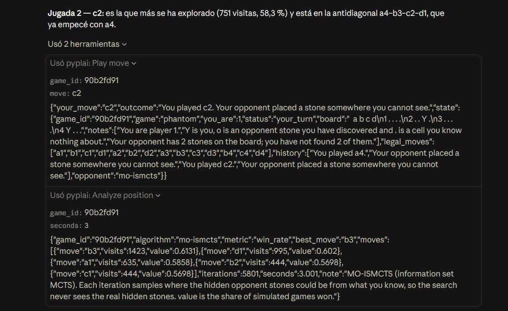

# pyplAI-MCP

An [MCP](https://modelcontextprotocol.io) server that lets a language model play board games
against search algorithms, and use those same algorithms as tools to choose its own moves.

Language models reason in words; they do not search. Ask one to play Ultimate tic-tac-toe and it
will explain its moves well and choose them badly. This server gives the model the search it lacks:
the Monte Carlo tree search, minimax and information set MCTS algorithms of
[pyplAI](https://github.com/plss12/pyplAI), my open-source Python library on
[PyPI](https://pypi.org/project/pyplAI/). The model calls `analyze_position`, gets every legal move
ranked with its win rate, and explains the choice in plain language.

Here is a real call (numbers vary between runs). The board is an Ultimate tic-tac-toe position
where the opponent has just won the centre board and sent you to the top-centre board, `B1`:

```json
{
  "algorithm": "mcts",
  "metric": "win_rate",
  "best_move": "B1:a3",
  "moves": [
    {"move": "B1:a3", "visits": 121, "value": 0.4711},
    {"move": "B1:c1", "visits": 70, "value": 0.4357},
    {"move": "B1:c3", "visits": 89, "value": 0.4326}
  ],
  "iterations": 777,
  "seconds": 2.001,
  "note": "Monte Carlo tree search (UCT). value is the share of simulated games won after each move, counting draws as half."
}
```

## Games

| Game | Information | Opponents and analysis |
| --- | --- | --- |
| Tic-tac-toe | Perfect | MCTS, minimax, random |
| Ultimate tic-tac-toe | Perfect | MCTS, minimax, random |
| Phantom (4,4,4) | Imperfect: you cannot see your opponent's stones | MO-ISMCTS, SO-ISMCTS, random |

Phantom is where the design matters. A perfect-information search would read the hidden stones
from the game state and cheat, so the server does not offer one. The information set searches
sample where the hidden stones could be from what the player knows, and a test plays whole games
checking that nothing the player receives reveals a hidden stone.

## Tools

| Tool | What it does |
| --- | --- |
| `list_games` | Games, move notation, opponents and analysis algorithms. |
| `get_rules` | The full rules of a game. |
| `new_game` | Starts a game. Options: who moves first, the opponent, its thinking time or depth, a seed and opening moves to set up a position. |
| `get_state` | The board as you see it, your legal moves and the history. |
| `play_move` | Plays your move; the opponent replies in the same call. Illegal moves return an error listing the legal ones. |
| `analyze_position` | Ranks your legal moves with MCTS, minimax or information set MCTS. |
| `end_game` | Frees a game. |

The rules are also the `rules://{game}` resource, but `get_rules` exists because a model often
cannot read resources on its own: in Claude Desktop it only calls tools. A `play_game` prompt asks
the model to analyse, explain and play a whole game, and every tool returns structured output with
a published schema.

## Use it

Requires [uv](https://docs.astral.sh/uv/). The server speaks MCP over stdio, and `uvx` installs and
runs it straight from this repository (it is not on PyPI yet).

**Claude Code**

```bash
claude mcp add pyplai -- uvx --from git+https://github.com/plss12/pyplAI-MCP pyplai-mcp
```

**Claude Desktop** (`claude_desktop_config.json`)

```json
{
  "mcpServers": {
    "pyplai": {
      "command": "uvx",
      "args": ["--from", "git+https://github.com/plss12/pyplAI-MCP", "pyplai-mcp"]
    }
  }
}
```

**Any other client:** run `uvx --from git+https://github.com/plss12/pyplAI-MCP pyplai-mcp` over stdio, or add
`--transport streamable-http --port 8000` and connect to `http://127.0.0.1:8000/mcp`.

Then ask for a game, for example: *"Play Phantom against the MO-ISMCTS opponent, and analyse each
position before you move."*

[Here is a real game](examples/phantom-claude-desktop.md) that Claude played and won from Claude
Desktop, analysing every position before moving:



## Design notes

- **The search never touches the real game.** Every analysis runs on a copy of the state, and in
  Phantom on samples of it.
- **Search runs off the event loop.** Tools are synchronous functions, which the MCP SDK runs on
  worker threads, so a 10-second search does not block other requests. Games are locked per
  session.
- **stdout belongs to the protocol.** Over stdio any stray `print` corrupts the JSON-RPC stream.
  pyplAI 1.1 added `analiza()` for exactly this reason: it returns the search statistics as data
  instead of printing them. Logs go to stderr, and an end-to-end test runs the server as a
  subprocess over stdio.
- **Errors the model can fix are tool errors.** An illegal move, a finished game or an unknown id
  comes back as a readable error, so the model can correct itself. Arguments are validated
  against their schema (for example, analysis time between 0.1 and 10 seconds).
- **Bounded memory.** At most 100 games are kept, and idle games expire after an hour.

## Benchmark

Does a small model play better with these tools? [`benchmarks/`](benchmarks/) lets Llama 3.2 3B,
served locally with Ollama, play 960 games through the server, with and without
`analyze_position`. In tic-tac-toe the tool cut its losses against MCTS from 100% to 31%, and in the
34 games where it followed every recommendation it never lost. In Ultimate tic-tac-toe it gained
little (8% wins, against 90% for the search alone), because it ignored the analysis most often
there. The search helps a small model about as much as the model trusts it.

## Development

```bash
uv sync
uv run pytest
uv run ruff check . && uv run ruff format --check .
uv run pyright
```

Try the tools by hand with the MCP Inspector:

```bash
npx @modelcontextprotocol/inspector uv run pyplai-mcp
```

## Roadmap

- Publish on PyPI, so it installs with `uvx pyplai-mcp`, and list it in the official MCP Registry.
- More pyplAI games: draughts, Escoba and Stratego.

## References

- C. B. Browne et al. A survey of Monte Carlo tree search methods. *IEEE TCIAIG*, 4(1), 2012.
- P. I. Cowling, E. J. Powley and D. Whitehouse. Information set Monte Carlo tree search.
  *IEEE TCIAIG*, 4(2), 2012.
- D. E. Knuth and R. W. Moore. An analysis of alpha-beta pruning. *Artificial Intelligence*, 6(4), 1975.

## License

MIT. Built on [pyplAI](https://github.com/plss12/pyplAI), by the same author.
